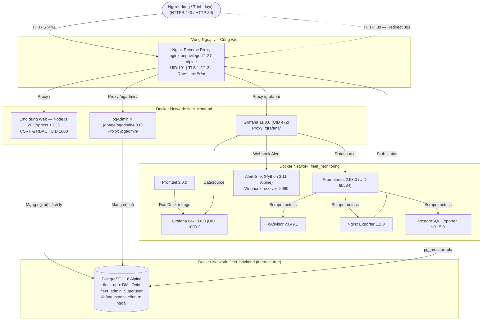

# Hệ thống Quản lý Đội xe (Fleet Management System)

**Môn học:** Triển khai và Quản trị Hệ thống Phần mềm (DevOps)  
**Sinh viên thực hiện:** Nguyễn Quang Vinh  
**Mã số sinh viên:** DTC245180115  
**Tên repository:** `DTC245180115-fleet-devops`

---

## Mục lục

1. [Giới thiệu dự án](#1-giới-thiệu-dự-án)
2. [Kiến trúc hệ thống](#2-kiến-trúc-hệ-thống)
3. [Yêu cầu hệ thống](#3-yêu-cầu-hệ-thống)
4. [Hướng dẫn khởi chạy](#4-hướng-dẫn-khởi-chạy)
5. [Địa chỉ truy cập và tài khoản mẫu](#5-địa-chỉ-truy-cập-và-tài-khoản-mẫu)
6. [Hướng dẫn sử dụng theo vai trò](#6-hướng-dẫn-sử-dụng-theo-vai-trò)
7. [Giám sát và nhật ký tập trung](#7-giám-sát-và-nhật-ký-tập-trung)
8. [Kiểm thử cảnh báo Brute Force](#8-kiểm-thử-cảnh-báo-brute-force)
9. [Các biện pháp bảo mật đã áp dụng](#9-các-biện-pháp-bảo-mật-đã-áp-dụng)
10. [Vận hành và dọn dẹp hệ thống](#10-vận-hành-và-dọn-dẹp-hệ-thống)
11. [Xử lý sự cố thường gặp](#11-xử-lý-sự-cố-thường-gặp)

---

## 1. Giới thiệu dự án

**Hệ thống Quản lý Đội xe (Fleet Management System)** là giải pháp phần mềm chuyên biệt phục vụ các đơn vị vận tải, doanh nghiệp logistics và quản lý phương tiện thương mại. Hệ thống được đóng gói hoàn chỉnh bằng Docker Compose (12 containers), tích hợp đầy đủ nghiệp vụ vận tải, hệ thống giám sát tập trung và các chuẩn mực bảo mật tiên tiến theo khung DevOps.

**Các tính năng nghiệp vụ chính:**

| Phân hệ | Mô tả chức năng |
|---|---|
| Quản lý phương tiện | Hồ sơ kỹ thuật, số km công tơ mét, loại xe, tình trạng hoạt động, upload ảnh thực tế |
| Điều phối chuyến xe | Lập lịch, phân công tài xế, xuất/nhập bến, in phiếu lệnh kèm mã QR. Chống Race Condition bằng `SELECT ... FOR UPDATE` |
| Nhiên liệu và bảo dưỡng | Nhật trình cấp phát nhiên liệu, lịch bảo dưỡng định kỳ, thống kê chi phí vận hành |
| Cảnh báo hạn vận hành | Phát hiện xe sắp hết hạn đăng kiểm, bảo hiểm, bảo dưỡng; tài xế sắp hết hạn giấy phép lái xe |
| Báo cáo và KPI | Chỉ số hiệu suất khai thác đội xe, biểu đồ doanh thu và chi phí theo kỳ |
| Giám sát hạ tầng | Prometheus + Grafana thu thập và hiển thị metrics thời gian thực |
| Nhật ký tập trung | Loki + Promtail thu thập log toàn hệ thống, phát hiện tấn công dò mật khẩu (Brute Force) |

---

## 2. Kiến trúc hệ thống

### 2.1. Sơ đồ kiến trúc



### 2.2. Phân tách mạng (Network Isolation)

| Network | Loại | Thành phần kết nối | Mục đích |
|---|---|---|---|
| `fleet_frontend` | Bridge | Nginx, Web, pgAdmin, Grafana | Lưu lượng giao diện người dùng |
| `fleet_backend` | **Internal** (cô lập hoàn toàn) | DB, Web, pgAdmin, PgExporter | Truy cập CSDL — không mở cổng ra ngoài |
| `fleet_monitoring` | Bridge | Prometheus, Loki, Promtail, Exporters, AlertSink | Lưu lượng giám sát và cảnh báo |

> **Lưu ý:** Mạng `fleet_backend` có thuộc tính `internal: true`. CSDL PostgreSQL không thể truy cập từ bên ngoài host trong mọi trường hợp.

---

## 3. Yêu cầu hệ thống

| Thành phần | Yêu cầu |
|---|---|
| Hệ điều hành | Linux (Ubuntu 22.04 LTS / Debian 12) hoặc Windows 10/11 + WSL 2 (khuyến nghị Ubuntu 22.04) |
| Docker Engine | >= 24.0.0 |
| Docker Compose | Plugin v2 >= 2.20.0 |
| Công cụ bắt buộc | Git, OpenSSL, Bash, cURL |
| CPU | Tối thiểu 2 cores (khuyến nghị 4 cores) |
| RAM | Tối thiểu 4 GB (khuyến nghị 6–8 GB để chạy ổn định 12 containers) |
| Ổ đĩa | Tối thiểu 10 GB dung lượng trống |

---

## 4. Hướng dẫn khởi chạy

Toàn bộ hệ thống khởi chạy từ trạng thái sạch chỉ với 4 bước.

### Bước 1: Sao chép mã nguồn

```bash
git clone https://github.com/vinhnq/DTC245180115-fleet-devops.git ~/fleet
cd ~/fleet
```

### Bước 2: Thiết lập biến môi trường

```bash
cp .env.example .env
chmod 600 .env
```

Có thể chỉnh sửa mật khẩu và chuỗi khóa bí mật trong tệp `.env` trước khi khởi chạy.

### Bước 3: Sinh chứng chỉ SSL/TLS

```bash
bash nginx/gen-cert.sh
```

Script tự động sinh cặp chứng chỉ x509 tự ký với SAN hỗ trợ `localhost` và `127.0.0.1`.

### Bước 4: Khởi chạy toàn bộ hệ thống

```bash
docker compose up -d --build
```

### Kiểm tra trạng thái sau khởi chạy

```bash
# Chờ 30–45 giây để các service hoàn tất khởi động và đạt trạng thái healthy
docker compose ps
```

Xác nhận toàn bộ **12/12 containers** đều ở trạng thái `Up (healthy)`.

---

## 5. Địa chỉ truy cập và tài khoản mẫu

### Địa chỉ dịch vụ

| Dịch vụ | Địa chỉ truy cập | Ghi chú |
|---|---|---|
| Ứng dụng Quản lý Đội xe | `https://localhost/` | HTTP :80 tự động redirect 301 sang HTTPS :443 |
| pgAdmin 4 | `https://localhost/pgadmin/` | Quản trị CSDL PostgreSQL qua giao diện trực quan |
| Grafana Dashboard | `https://localhost/grafana/` | 4 Dashboard giám sát được nạp tự động sẵn |
| Prometheus UI | Mạng nội bộ (:9090) | Chỉ truy cập qua mạng nội bộ Docker |
| Loki Log Engine | Mạng nội bộ (:3100) | Chỉ truy cập qua Grafana Explore |

### Tài khoản mẫu

> **Lưu ý bảo mật:** Mật khẩu thực tế của tất cả tài khoản được quản lý trong tệp `.env`. Không ghi mật khẩu thật vào tài liệu.

| Vai trò | Tên đăng nhập | Biến `.env` tương ứng | Phạm vi quyền hạn |
|---|---|---|---|
| Quản trị viên (Admin) | `admin` | `SEED_ADMIN_PASSWORD` | Toàn quyền: danh mục xe, upload ảnh, quản lý tài khoản, KPI |
| Điều phối viên | `dieuphoi01`, `dieuphoi02` | `SEED_DISP_PASSWORD` | Tạo chuyến, điều động tài xế, bảo dưỡng, in phiếu lệnh QR |
| Tài xế | `taixe01`, `taixe02` | `SEED_DRIVER_PASSWORD` | Xem chuyến được giao, bắt đầu/kết thúc chuyến, ghi nhiên liệu |
| Quản trị pgAdmin | `admin@fleet.local` | `PGADMIN_DEFAULT_PASSWORD` | Quản trị bảng, chỉ mục, truy vấn CSDL |
| Quản trị Grafana | `fleetadmin` | `GF_SECURITY_ADMIN_PASSWORD` | Xem Dashboard, cấu hình Alert, truy vấn LogQL |

---

## 6. Hướng dẫn sử dụng theo vai trò

### 6.1. Điều phối viên (Dispatcher)

**Xem và theo dõi danh sách chuyến xe**

Truy cập menu **Chuyến xe** (`/trips`) để theo dõi toàn bộ trạng thái: `Dự kiến` → `Đang thực hiện` → `Hoàn thành` / `Đã hủy`.

**Tạo và điều động chuyến xe**

1. Nhấn **Tạo chuyến mới** (`/trips/create`).
2. Chọn phương tiện còn trống (`available`), chọn tài xế, điểm đi, điểm đến, thời gian dự kiến và mục đích chuyến.
3. Nhấn **Lưu**. Hệ thống tự động khóa dòng CSDL (`SELECT ... FOR UPDATE`) để chống phân công trùng lặp (Race Condition).

**In phiếu lệnh điều xe kèm mã QR**

Tại danh sách chuyến, nhấn **In phiếu lệnh** (`/trips/:id/print`). Hệ thống kết xuất phiếu lệnh chuẩn in ấn kèm mã QR chứa thông tin chuyến được sinh động từ máy chủ.

**Theo dõi cảnh báo**

Vào menu **Cảnh báo** (`/alerts`) để kiểm tra: xe sắp hết hạn đăng kiểm (dưới 30 ngày), hạn bảo hiểm, xe sắp đến hạn bảo dưỡng và tài xế sắp hết hạn giấy phép lái xe.

### 6.2. Tài xế (Driver)

**Xem chuyến được phân công**

Đăng nhập bằng tài khoản tài xế, hệ thống tự động điều hướng về trang **Chuyến xe của tôi** (`/trips/driver`).

**Bắt đầu chuyến — Xuất bến**

Nhấn **Bắt đầu chuyến**, nhập số km công tơ mét hiện tại (phải lớn hơn hoặc bằng km lần trước). Trạng thái chuyến chuyển thành `in_progress`, trạng thái xe chuyển thành `in_use`.

**Kết thúc chuyến — Về bến**

Nhấn **Kết thúc chuyến**, nhập số km khi về bến. Hệ thống tự tính quãng đường, cập nhật công tơ mét xe và đưa phương tiện về trạng thái `available`.

**Ghi nhận nhiên liệu**

Vào **Nhiên liệu** → **Thêm mới** (`/fuel/create`), chọn chuyến và nhập số lít, đơn giá, tổng tiền, số km tương ứng.

### 6.3. Quản trị viên (Admin)

**Quản lý danh mục xe và upload ảnh**

Vào **Phương tiện** → **Thêm phương tiện mới** (`/vehicles/create`): nhập biển số, loại xe, hãng sản xuất, model, năm sản xuất, số chỗ ngồi, km ban đầu, hạn kiểm định và upload ảnh thực tế (JPG/PNG, lưu trong volume `web_uploads`).

**Thanh lý phương tiện**

Vào chi tiết xe (`/vehicles/:id`), nhấn **Thanh lý xe** để chuyển trạng thái sang `retired`.

**Quản lý tài khoản người dùng**

Vào **Hệ thống** → **Người dùng** (`/admin/users`): tạo tài khoản mới hoặc khóa/mở khóa tài khoản nhân viên.

**Xem báo cáo KPI**

Vào **Báo cáo KPI** (`/kpi`): xem tỷ lệ xe sẵn sàng, tổng chi phí vận hành, chi phí nhiên liệu trung bình/100km.

---

## 7. Giám sát và nhật ký tập trung

### 7.1. Danh mục 4 Dashboard Grafana

Truy cập `https://localhost/grafana/` và đăng nhập bằng tài khoản `fleetadmin`:

| Dashboard | Đường dẫn | Nội dung |
|---|---|---|
| Fleet - Containers | `/grafana/d/fleet-containers/` | CPU %, RAM, Network I/O, Disk I/O của 12 containers |
| Fleet - PostgreSQL | `/grafana/d/fleet-postgres/` | Connections, Transactions/sec, Cache Hit Ratio, kích thước DB |
| Fleet - Nginx | `/grafana/d/fleet-nginx/` | Requests/sec, Active connections, tỷ lệ HTTP 2xx/4xx/5xx |
| Fleet - Logs | `/grafana/d/fleet-logs/` | Nhật ký toàn hệ thống từ Loki theo thời gian thực |

### 7.2. Câu truy vấn LogQL mẫu

Vào mục **Explore** trong Grafana, chọn Datasource **Loki**:

```logql
# Toàn bộ log ứng dụng web
{job="webapp"}

# Truy vết các lần đăng nhập thất bại (Security Audit)
{job="webapp"} |= "LOGIN_FAILED"

# Audit trail thay đổi trạng thái chuyến xe
{job="webapp"} |= "TRIP_STATUS_CHANGE"

# Nhật ký truy cập Nginx (Access Log)
{job="nginx"}

# Lọc các yêu cầu trả về lỗi HTTP 4xx hoặc 5xx
{job="nginx"} |~ "HTTP/1.[01]\" [45]"

# Biểu đồ tần suất lỗi ứng dụng theo thời gian (errors/min)
sum(rate({job="webapp"} |= "ERROR" [1m])) by (container_name)
```

---

## 8. Kiểm thử cảnh báo Brute Force

Hệ thống tích hợp giám sát an ninh tự động. Khi phát hiện hơn 5 lần đăng nhập thất bại (`LOGIN_FAILED`) trong vòng 1 phút, Grafana Alerting sẽ kích hoạt cảnh báo mức **Critical** và gửi Webhook tới dịch vụ `alert-sink`.

**Bước 1 — Chạy tập lệnh mô phỏng tấn công dò mật khẩu:**

```bash
bash scripts/simulate_bruteforce.sh
# Tập lệnh gửi liên tiếp 7 yêu cầu đăng nhập sai tới /login
```

**Bước 2 — Quan sát cảnh báo trên Grafana:**

Truy cập `https://localhost/grafana/alerting/list`. Cảnh báo **Fleet - Brute force login** chuyển từ trạng thái `Normal` sang `Firing`.

**Bước 3 — Kiểm tra dữ liệu Webhook tại Alert-Sink:**

```bash
docker exec fleet_prometheus wget -qO- http://alert-sink:9099/alerts
```

Kết quả trả về payload JSON: `status: firing`, `severity: critical` và dấu thời gian kích hoạt.

Xem thêm: [`docs/su-co-bruteforce.md`](docs/su-co-bruteforce.md)

---

## 9. Các biện pháp bảo mật đã áp dụng

Hệ thống tuân thủ 11 lớp bảo mật theo chuẩn OWASP và CIS Docker Benchmark:

| # | Biện pháp | Chi tiết triển khai |
|---|---|---|
| 1 | **Non-root Containers** | `web` uid=1000, `nginx` uid=101, `db` uid=999, `grafana` uid=472, `loki` uid=10001, `prometheus` & exporters uid=65534 |
| 2 | **Phân quyền CSDL tối thiểu** | `fleet_app` chỉ có DML. Thực thi `DROP TABLE vehicles` → `ERROR: must be owner of table vehicles` |
| 3 | **Network Isolation** | `fleet_backend` có `internal: true` — CSDL hoàn toàn cô lập, không mở cổng ra host |
| 4 | **Drop Linux Capabilities** | `cap_drop: [ALL]` và `security_opt: [no-new-privileges:true]` trên toàn bộ 12 containers |
| 5 | **Read-only Filesystem** | Container stateless (`nginx`, `alert-sink`) dùng `read_only: true` kết hợp `tmpfs: [/tmp]` |
| 6 | **Resource Limits** | Giới hạn trần CPU và RAM cho tất cả 12 containers, loại trừ khả năng tấn công DoS |
| 7 | **Rate Limiting (Brute Force)** | `limit_req_zone rate=5r/m burst=5 nodelay` trên `/login` — vi phạm trả về `HTTP 429` |
| 8 | **HTTP Security Headers** | HSTS (max-age 1 năm), CSP, `X-Frame-Options: SAMEORIGIN`, `X-Content-Type-Options: nosniff`, `Permissions-Policy`, `server_tokens off` |
| 9 | **Chặn endpoint nội bộ** | `/nginx_status` chỉ cho phép mạng monitoring (172.x.x.x), ngoài phạm vi → `HTTP 404` |
| 10 | **Bảo vệ chống tấn công Web** | CSRF Token trên mọi form POST; kiểm tra phân quyền IDOR ở tầng Controller; Cookie `HttpOnly + SameSite=Lax + Secure` |
| 11 | **Trivy Security Scan** | Quét lỗ hổng trên 6 container images. Kết quả tại `evidence/buoc6-trivy.txt` |

---

## 10. Vận hành và dọn dẹp hệ thống

```bash
# Dừng hệ thống tạm thời — giải phóng CPU và RAM, giữ nguyên trạng thái container
docker compose stop

# Khởi động lại sau khi dừng
docker compose start

# Hạ hệ thống, xóa container và network — DỮ LIỆU TRONG VOLUME ĐƯỢC GIỮ LẠI
docker compose down

# Xóa toàn bộ — container, network VÀ dữ liệu (khôi phục trạng thái xuất xưởng)
docker compose down -v

# Thu hồi bộ nhớ RAM của máy ảo WSL 2 — chạy trên PowerShell Windows
wsl --shutdown
```

> **Lưu ý quan trọng:** Sử dụng `docker compose down` (không có cờ `-v`) để dừng hệ thống trong khi vẫn bảo toàn dữ liệu trong các named volumes (`pgdata`, `grafana_data`, `loki_data`, `web_uploads`).

---

## 11. Xử lý sự cố thường gặp

**Lỗi `Permission denied` khi Nginx đọc chứng chỉ `server.key`**

- *Nguyên nhân:* Nginx chạy dưới `uid=101`, không đọc được tệp khóa riêng nếu quyền là `600` thuộc sở hữu `root`.
- *Khắc phục:*
  ```bash
  chmod 644 nginx/certs/server.key
  docker compose restart nginx
  ```

**Lỗi xung đột cổng 80 hoặc 443**

- *Nguyên nhân:* IIS, Apache, Skype hoặc VMware đang chiếm dụng cổng 80/443 trên máy host.
- *Khắc phục (Windows):*
  ```powershell
  net stop w3svc   # Dừng IIS Web Server
  ```
  Hoặc điều chỉnh ánh xạ cổng trong `docker-compose.yml` (ví dụ: `"8080:8080"`, `"8443:8443"`).

**Lỗi `HTTP 429 Too Many Requests` khi đăng nhập hoặc kiểm thử**

- *Nguyên nhân:* Cơ chế Rate Limiting của Nginx đang hoạt động, giới hạn tối đa 5 yêu cầu/phút trên endpoint `/login`.
- *Khắc phục:* Chờ 12 giây để bộ nhớ đệm (leaky bucket) giải phóng trước khi thao tác lại.

**Trình duyệt hiển thị cảnh báo chứng chỉ không bảo mật**

- *Nguyên nhân:* Chứng chỉ SSL/TLS được tự ký (self-signed) trong môi trường phát triển nội bộ, chưa được cấp bởi CA tin cậy.
- *Khắc phục:* Nhấn **Nâng cao (Advanced)** → **Tiếp tục truy cập localhost (không an toàn)**. Toàn bộ phiên truyền thông vẫn được mã hóa bằng giao thức TLSv1.3.

---

## Tài liệu tham khảo

| Tài liệu | Đường dẫn |
|---|---|
| Báo cáo chi tiết cho bài thi | [`docs/cho-bao-cao.md`](docs/cho-bao-cao.md) |
| Báo cáo sự cố Brute Force | [`docs/su-co-bruteforce.md`](docs/su-co-bruteforce.md) |
| Bảng phiên bản phần mềm | [`docs/phien-ban.md`](docs/phien-ban.md) |
| Bằng chứng kiểm thử | [`evidence/`](evidence/) |